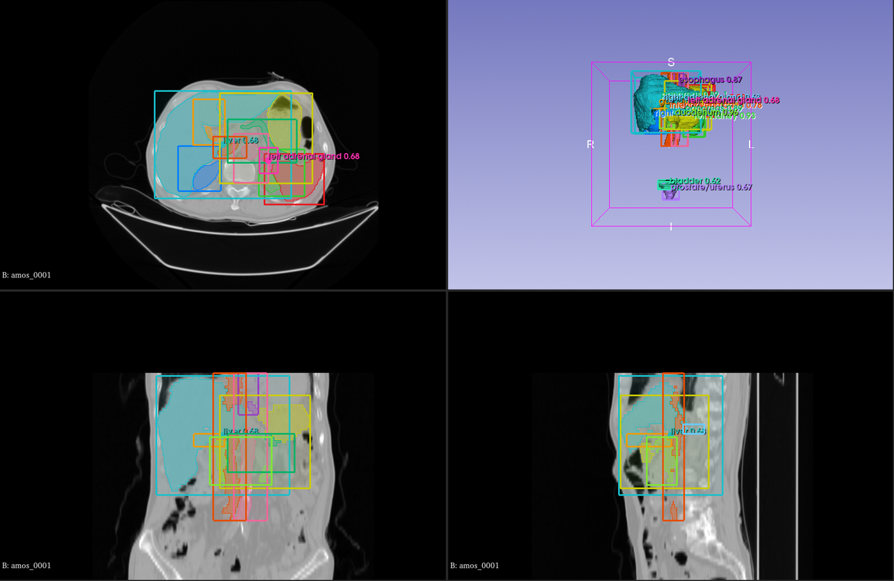

# SlicerMLArray

A [3D Slicer](https://www.slicer.org) extension for [MLArray](https://github.com/MIC-DKFZ/mlarray) (`.mla`) files:
open them with **File > Add Data** and save volumes and segmentations with **File > Save**. Images are placed
exactly where the file's geometry puts them, label maps open as segmentations with their names, colours and codes,
and bounding boxes as ROIs.

<p align="center"></p>

## Install

- **Extensions Manager** (once published): search for *MLArray*.
- **From source:** clone this repository, then in Slicer *Edit > Application Settings > Modules > Additional module
  paths* add the `SlicerMLArray/SlicerMLArray` folder and restart.

The first time an `.mla` file is opened or saved, Slicer asks to install the Python package `mlarray` (1.x).

## What you see

| in the file | in Slicer |
|---|---|
| image (2-D or 3-D) | scalar volume |
| `values.kind: label` | segmentation: one segment per label with its name, colour and code (as terminology); or a labelmap volume (module setting) |
| `values.kind: instance` | labelmap volume |
| channel axis with `red, green, blue` labels, component axis | vector volume |
| other channel axis (MR echoes, modalities) | one volume per channel, named by the channel labels |
| time axis | sequence (with its times); play it with the Sequences toolbar |
| `label_layout: channel` (one-hot) | segmentation, one segment per channel (overlaps allowed) |
| `profiles.ml.boxes` | one Markups ROI per box, named `class score` (e.g. `tumor 0.84`), coloured by class, in a folder `<file> boxes` |

- **Geometry.** Every voxel is placed from the file's space matrix and the direction words of its axes
  (`increases_toward`); letter codes are never used. The array is used as stored (no reorientation, no resampling),
  so oblique and sheared grids are exact; Slicer aligns its slice views with the image when it is shown. Units are
  converted to millimetre. A space without anatomical directions (e.g. a microscope stage) is shown with its axes
  toward left, posterior, superior, and a warning says so.
- **Values** are shown physically: scaling (`scale`, `offset`, e.g. Hounsfield units) is applied, keeping integer
  types where the result is integer.
- **Boxes** follow the voxel grid, also for flipped and oblique images; a box covers its voxels from edge to edge.
  Files that only hold boxes (empty array) open as ROIs only.
- Layouts Slicer cannot show (more than one non-space axis, more than three space axes) are refused with the reason.

## Saving

**File > Save** offers *MLArray (.mla)* for scalar, labelmap and vector volumes and segmentations (it is the
default format for nodes opened from `.mla`).

- A node opened from `.mla` keeps all metadata of its file: axis names and order, spaces, source (e.g. DICOM
  headers), user metadata, profiles and history; a history entry is added. Unchanged geometry keeps its exact
  matrix; a moved or resampled image gets its space recomputed. Scaled values are stored again with the original
  type and scaling when they still fit.
- A segmentation is saved as a label map on its file's grid (or its reference image's grid). Overlapping segments
  cannot be stored in one label map: the save stops and says which segment overlaps. Segments keep their values,
  names, colours and codes; new segments get the next free value.
- A new node is written in the DICOM patient frame (left, posterior, superior; millimetre), the same frame MedVol
  writes, so a volume saved from Slicer and the same image converted with MedVol match.

**Boxes**: module *MLArray* (category *Informatics*) > *Export boxes*: pick ROIs and a file. With an image selected,
the boxes are stored in that image's voxel indices; otherwise ROIs from an `.mla` file are written in that file's
frame, and new ROIs in patient coordinates (LPS, mm). The ROI's label and score are kept.

## Python

```python
logic = slicer.util.getModuleLogic("SlicerMLArray")
nodes = logic.load("case.mla")
logic.save(segmentationNode, "case_seg.mla")
logic.saveBoxes(roiNodes, "case_boxes.mla", referenceVolume)
```

## Development

The Slicer-independent part (`SlicerMLArray/SlicerMLArrayLib`: geometry, layouts, values, boxes, metadata) is
tested with pytest:

```bash
pip install "mlarray>=1,<2" "medvol>=1.0.1" nibabel pynrrd pytest
pytest
```

Inside Slicer: the module's self-test (*Developer mode > Reload and Test*), and `scripts/verify_in_slicer.py`, which
checks the orientation-KB letter phantoms against Slicer's own NIfTI/NRRD readers, every layout, save round trips
and the example datasets (see the script's docstring; test data from `scripts/make_verify_data.py`).

## License

MIT (see `LICENSE.txt`).

## Acknowledgments

<p align="left">
   &nbsp;&nbsp;&nbsp;&nbsp;
  
</p>

This repository is developed and maintained by the Applied Computer Vision Lab (ACVL)
of [Helmholtz Imaging](https://www.helmholtz-imaging.de/) and the
[Division of Medical Image Computing](https://www.dkfz.de/en/medical-image-computing) at DKFZ.
